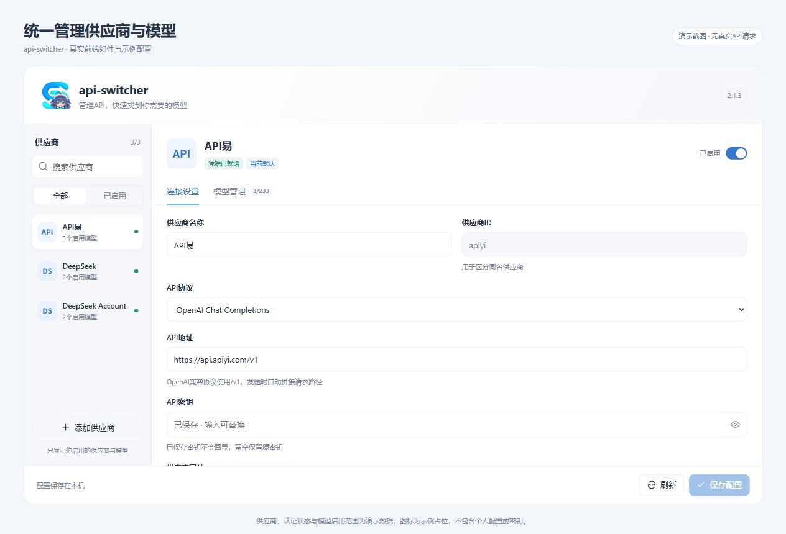
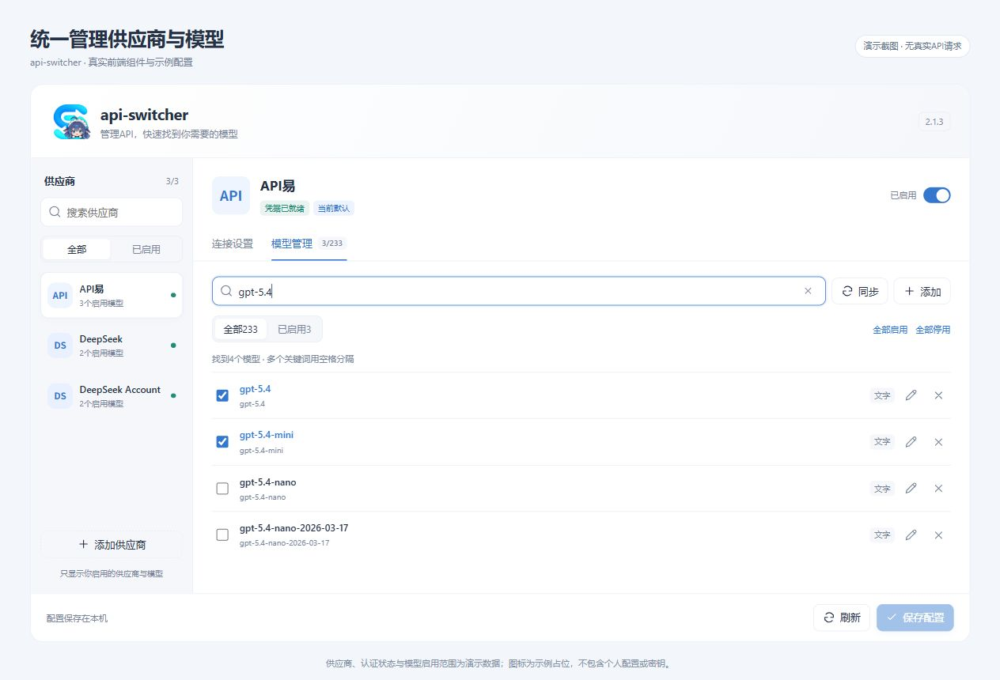
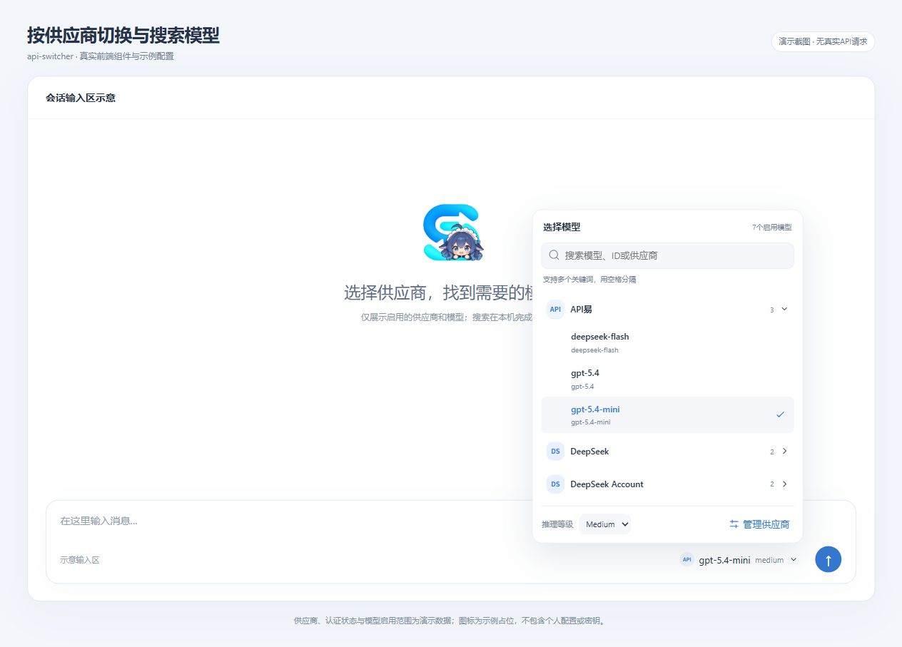
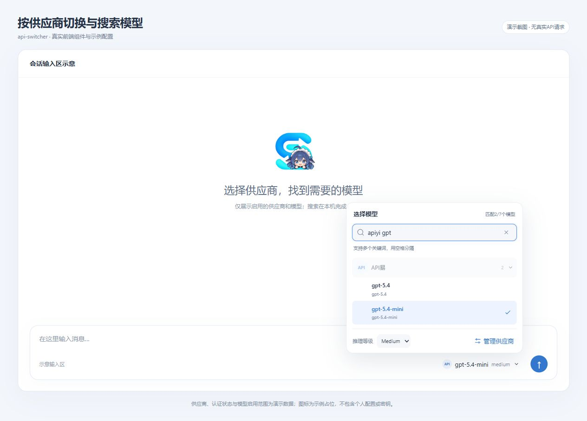

# api-switcher

<p align="center"></p>

在一个设置页管理 API 供应商，在会话输入框旁搜索和切换模型。支持官方 API、兼容接口、聚合供应商和 DSH 原生账号。

当前版本 **2.3.0**，新增按供应商、协议和模型匹配的思考控制，以及原生协议来源创建。

[下载](https://github.com/ccl4-56-23-5/DSH-Plugins/releases/tag/api-switcher-v2.3.0) · [安装](docs/INSTALLATION.md) · [使用指南](docs/USER_GUIDE.md) · [更新记录](CHANGELOG.md)

## 功能

| 功能 | 说明 |
| --- | --- |
| 供应商管理 | 编辑名称、API 地址、协议、密钥、网站和图标，分别控制启用状态 |
| 模型管理 | 同步目录、手动添加和编辑模型，选择会话菜单中的可用模型 |
| 分组与搜索 | 按供应商分组，搜索模型与供应商的名称或 ID，支持多个关键词 |
| 协议 | OpenAI Chat Completions、OpenAI Responses、Anthropic Messages |
| 模型参数 | 配置文本/图片输入、上下文窗口、输出预算和思考参数 |
| 快速配置 | 提供 API 易、小米 MiMo 模板，获取网站图标并测试连接 |
| 键盘操作 | 方向键选择、回车确认、Esc 关闭、一键清空搜索 |

选择模型会更新当前会话的下一次请求，并保存新会话默认模型。

## 界面

以下图片使用 2.1.3 前端组件与示例数据，展示供应商管理和模型菜单；2.3.0 的容量与思考编辑器已有更新。

### 配置供应商

选择左侧供应商，在“连接设置”填写协议、API 地址和密钥。右上角控制启用状态，网站、图标和连接测试位于下方，编辑后点击“保存配置”。



### 启用常用模型

在“模型管理”搜索目录、勾选模型、同步目录或手动添加。会话菜单显示保存后已启用的模型。



### 按供应商切换

点击发送按钮旁的模型名称，展开供应商分组并选择模型。底部“管理供应商”打开设置页。



### 多关键词搜索

输入 `apiyi gpt`，筛选同时匹配供应商和模型名称的结果。搜索兼容大小写、全角字符和常见 ID 分隔符，清空后恢复原分组状态。



## 安装

通过 DSH 插件管理添加 Release 中的 `dsh-api-switcher-2.3.0.tgz`。Windows 用户也可下载 ZIP，解压后完成正在运行的 DSH 任务，再运行 `安装.cmd`。安装器校验文件、备份配置并重启 DSH。

默认宿主目录为 `D:\DeepSeekHarness`，配置目录为 `%USERPROFILE%\.dsh`，profile 为 `desktop`。其他位置、升级与恢复见 [安装说明](docs/INSTALLATION.md)。

## 配置与使用

“添加供应商”提供小米 MiMo 模板，可填写密钥后启用。API 易预配置地址为 `https://api.apiyi.com/v1`，使用 Chat Completions 协议，首次填写自己的密钥并选择模型后启用。

模型容量可分别选择自动获取、手动设置或 DSH 默认值。思考控制按地址、协议和模型匹配：MiMo 显示开关，已适配的 GPT/Claude 显示对应档位；其他组合可使用供应商默认或手动配置。

搜索和切换模型在本地完成；同步目录、获取图标会访问对应服务。“测试连接”发送真实模型请求，可能计费。

## 文档

| 文档 | 内容 |
| --- | --- |
| [使用指南](docs/USER_GUIDE.md) | 供应商、模型、搜索、连接测试与保存冲突 |
| [安装说明](docs/INSTALLATION.md) | Windows 安装、自定义位置、升级、恢复与卸载 |
| [API 易](docs/APIYI.md) · [MiMo](docs/MIMO.md) | 地址、协议与模型目录 |
| [模型能力与容量](docs/CAPABILITIES.md) · [思考控制](docs/REASONING.md) | 参数来源、配置方式与适配表 |
| [架构与接口](docs/ARCHITECTURE.md) · [开发与发布](docs/DEVELOPMENT.md) | 模块、宿主服务、测试与构建 |
| [故障排查](docs/TROUBLESHOOTING.md) | 认证、目录、网络与安装问题 |
| [验证记录](docs/VALIDATION.md) · [截图来源](docs/screenshots/README.md) | 测试环境、结果与图片来源 |
| [安全说明](SECURITY.md) · [贡献指南](CONTRIBUTING.md) | 凭据处理与提交要求 |

## 开发

要求 Node.js 20 或以上，无额外 npm 运行依赖。

```sh
node scripts/run-tests.mjs
node scripts/check-project.mjs
node scripts/build-release.mjs
```

构建结果位于 `dist/`，Windows 运行 `Build-Release.ps1` 可生成安装 ZIP。

代码与原创文档采用 [MIT 许可](LICENSE)，依赖和素材来源见 [第三方声明](THIRD_PARTY_NOTICES.md)，图标规格见 [品牌资产](docs/BRANDING.md)。
