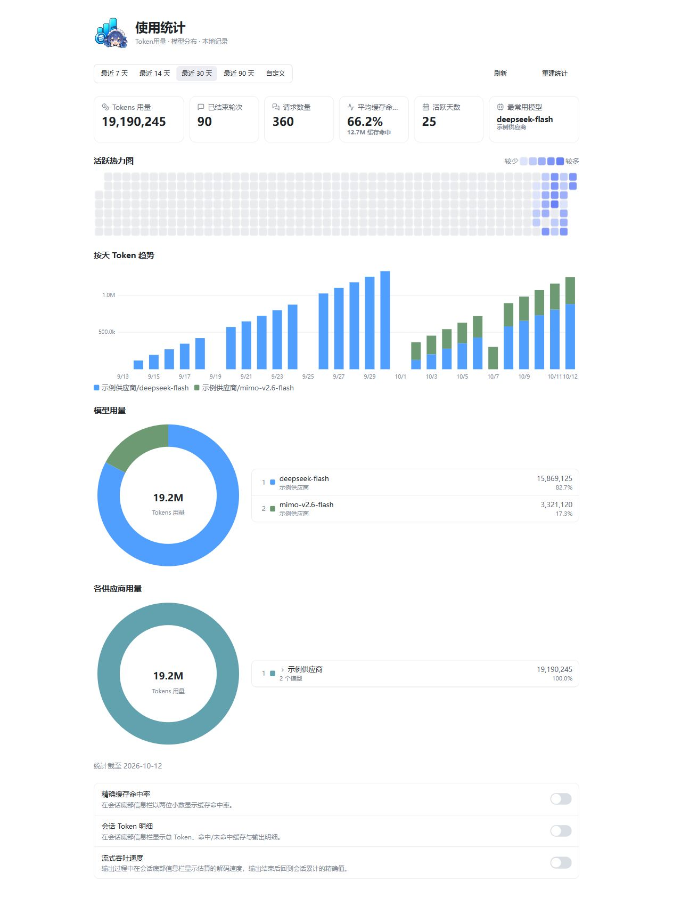

# 使用统计·大肥鱼定制版1.0.0


基于[HaoyueQin/dsh-usage-statistics-panel](https://github.com/HaoyueQin/dsh-usage-statistics-panel)0.3.2定制，保留原统计数据、采集逻辑、设置和左上角入口。不是另装一套并行统计。

## 界面

- 顶部用量卡片、52周方块活跃热力图，结合简洁的看板标题和留白。
- 按天Token趋势保留模型堆叠柱状图；移除缓存命中率折线、悬停圆点、右侧百分比轴及图例。缓存命中率仍在顶部和悬停明细中可查。
- 保留模型/供应商环形占比、排名、悬停联动与Other展开。
- 保留7/14/30/90天和自定义日期、刷新、重建统计与底部三项信息栏增强。
- 主界面左上角“使用统计”直接打开；返回按钮回到原页面。插件详情页也可打开同一看板。
- 原“会话数量”按实际含义改为“已结束轮次”。



## 替换安装

下载本版本Windows ZIP，解压后退出DSH，双击`安装.cmd`。默认宿主目录为`D:\DeepSeekHarness`；其他目录运行：

```powershell
.\Install-DSH.ps1 -DshRoot 'D:\你的DSH目录'
```

包名仍为`dsh-usage-statistics-panel`，安装器替换原版本入口，不新增重复侧栏。保留`usage_history`统计域和现有浏览器设置，不触发重建。安装器备份profile清单和锁文件；失败时恢复原清单并尝试离线重装。配置备份位于用户DSH目录的`token-usage/deployment-backups/`。

插件自有运行依赖已打入JS，使用DSH自带Node/pnpm，无需另外安装Node。仅要求宿主提供原有DSH服务和React；适配目标与上游相同：DSH0.1.7-rc.2。来源和许可证见[第三方声明](THIRD_PARTY_NOTICES.md)。

## 统计口径与数据保护

沿用上游：未缓存输入、输出、缓存读取、缓存写入四个不相交桶之和为总Token；命中率为`缓存读/(未缓存输入+缓存读+缓存写)`。请求数来自实际调用开始标记，失败且无用量的调用也计请求数。已结束轮次不等于独立聊天数。子代理纳入；分支继承前缀跳过；实时采集和回扫通过持久化游标避免重启翻倍。

数据继续位于`$DSH_HOME/storages/usage_history.json`。本版不改变采集、存储、聚合或重建算法。重建会重新扫描当前保留的会话日志，因此没有需要时不要点击重建。缺失provider用量的请求无法精确回溯；统计不是付款账单。既有上游限制及底层设计见[设计说明](docs/design.md)，该文件中的折线描述属于上游0.3.2，已在本版移除。

## 开发与交付

上游基线：657953bfe5567dd33299d1ca417058285071d433。MIT版权声明原样保留。构建使用锁文件；运行`node scripts/build-local.mjs`完成类型检查、编译、品牌文件导出和测试。运行`node scripts/build-release.mjs`生成安装TGZ、Windows ZIP、manifest和SHA-256。

[验证记录](VALIDATION.md) · [生成记录](assets/branding.json) · [上游项目](https://github.com/HaoyueQin/dsh-usage-statistics-panel)
